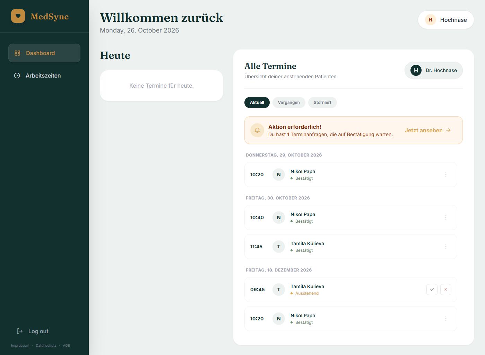
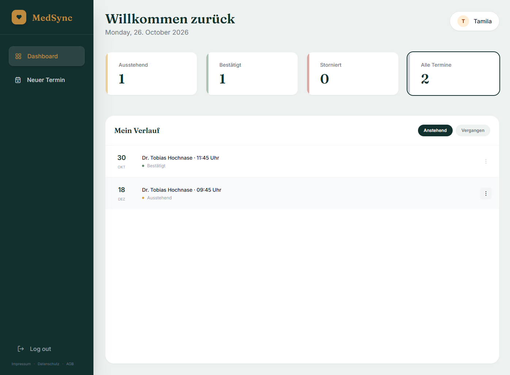
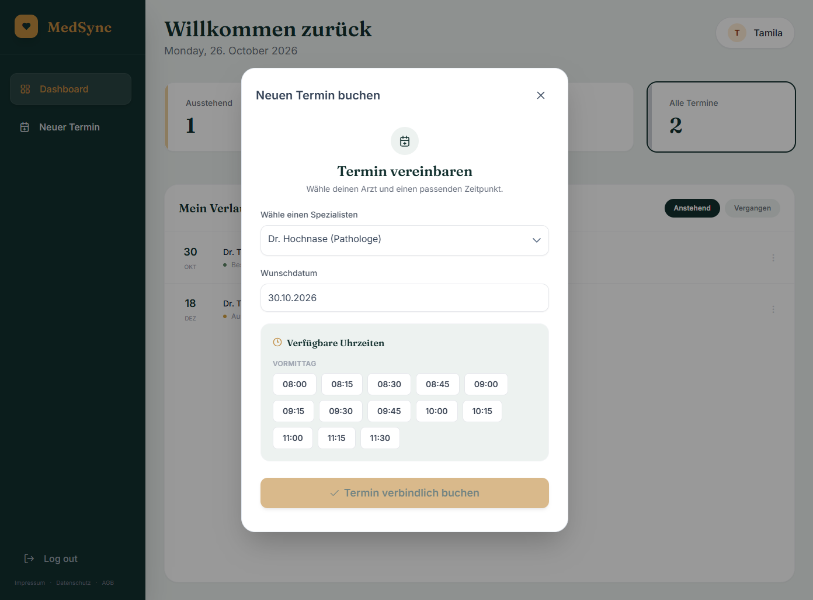
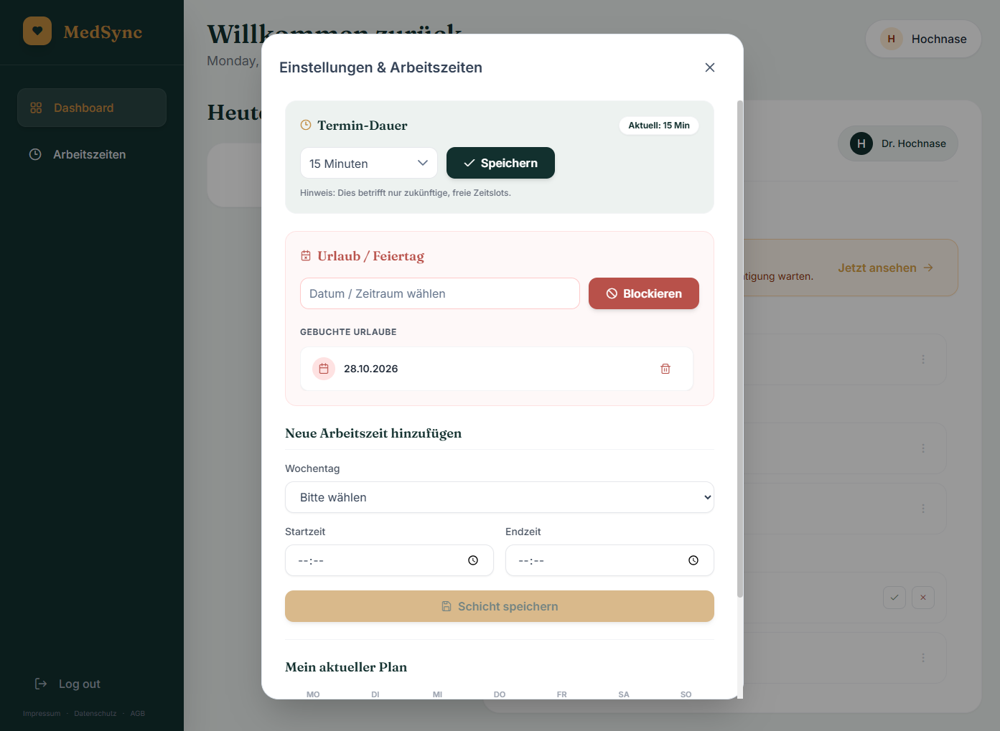
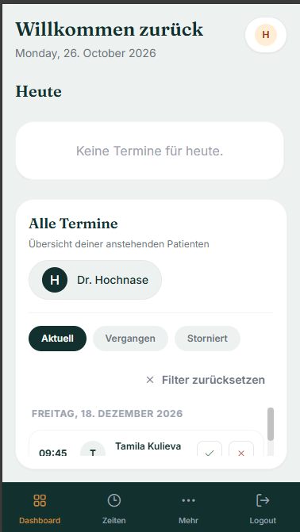

# MedSync – Frontend


Angular-Frontend für die Terminverwaltung von Arztpraxen.
Backend: [medical-app-backend](https://github.com/NikolPap/medical-app-backend)

> **Demo-Projekt.** Keine echten Patientendaten eingeben.


## Screenshots

| Arzt-Dashboard | Patienten-Dashboard |

|  |  |

| Termin buchen | Einstellungen & Arbeitszeiten | Mobil |

|  |  |  |


## Features

- Rollenbasierte Oberflächen: Patient, Arzt, Admin (Role-Guards)
- Terminbuchung mit Live-Verfügbarkeit: freie Slots kommen direkt aus der Backend-Engine
- Verschieben und Stornieren (48-Stunden-Regel wird im UI berücksichtigt)
- Arzt: Arbeitszeiten, Urlaubsverwaltung, Terminbestätigung
- Admin: Freischaltung neuer Ärzte
- Registrierung mit E-Mail-Verifizierung, Passwort-Reset
- Responsive Design (Sidebar auf Desktop, Bottom-Navigation auf Mobil)
- Eigenes Design-System (Tailwind): Ink Teal, Cool Paper, Warm Brass; Fraunces und Inter
- Schriften lokal eingebunden (kein Google-Fonts-Request, DSGVO-freundlich)

## Tech-Stack

Angular 21 (Standalone Components, Signals) · TypeScript · RxJS · Tailwind CSS ·
PrimeNG 21 · FullCalendar · JWT-Interceptor und Guards · Docker/nginx · GitHub Actions

## Architektur

- **Modernes Angular:** `inject()` statt Konstruktor-Injection, `signal()`/`computed()`
  für State und abgeleitete Listen, `input()`/`output()` statt Decorators,
  Control Flow (`@if`/`@for`) statt `*ngIf`/`*ngFor`
- **Smart/Dumb-Components:** `DashboardComponent` hält den State, kleine Komponenten
  (`AppointmentRow`, `SummaryCards`, ...) bekommen nur Inputs und senden Outputs
- Wiederverwendbare Pipes für Status-Label und -Farben
- `core/` (Services, Guards, Interceptor, Models), `features/` (auth, dashboard, admin, legal), `shared/`

## Starten

Voraussetzungen: Node 24 (npm 11) und ein laufendes Backend auf `http://localhost:8080`
([Anleitung](https://github.com/NikolPap/medical-app-backend#starten)).

```bash
npm ci
npm start            # http://localhost:4200
```

Mit Docker:

```bash
docker build -t medsync-frontend .
docker run --rm -p 4200:80 medsync-frontend
```

## Entscheidungen

- **Signals statt manueller Updates:** Gefilterte und paginierte Listen sind `computed()`-Werte.
  Es gibt keine `update…()`-Methoden mehr, die man nach einer Änderung vergessen könnte.
- **Smart/Dumb-Split:** Das Dashboard-Template schrumpfte von ~450 auf ~55 Zeilen.
- **Token im localStorage:** einfach für eine SPA; bekanntes XSS-Risiko,
  Alternative wäre ein httpOnly-Cookie.
- **Role-Guard prüft auch `exp`:** abgelaufene Tokens führen zum Login statt zu 401-Fehlern.
- **Abhängigkeiten sauber aufgelöst:** PrimeNG 21 und FullCalendar auf einheitlicher Version,
  deshalb ist kein `--legacy-peer-deps` nötig.
